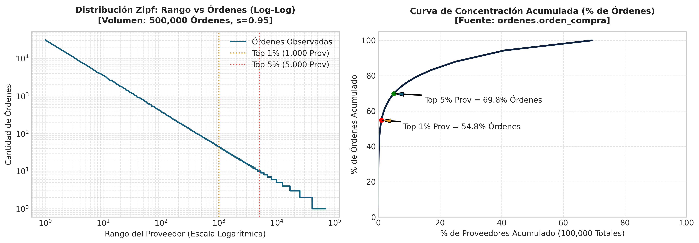
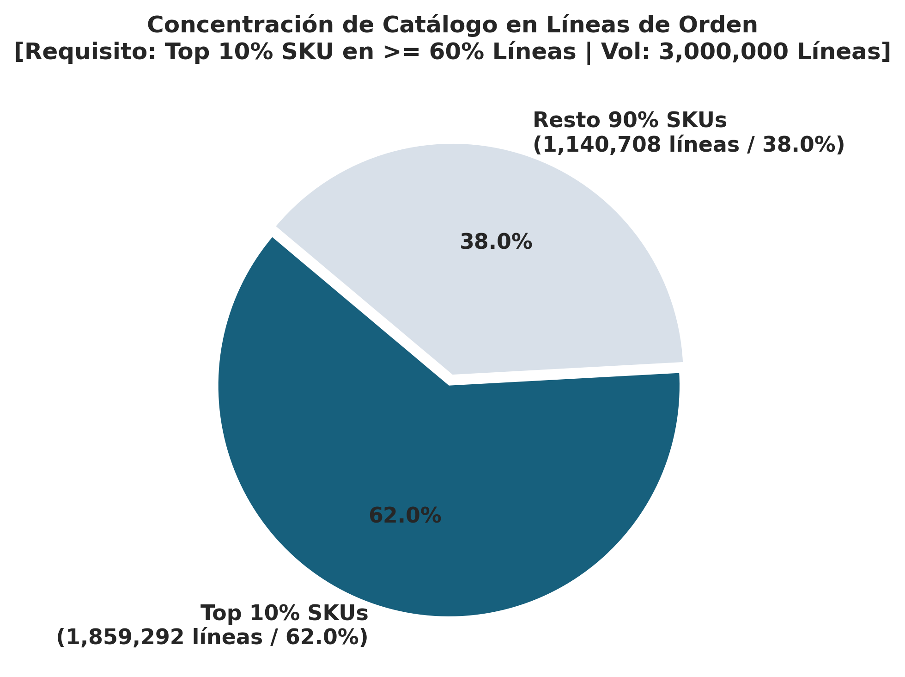
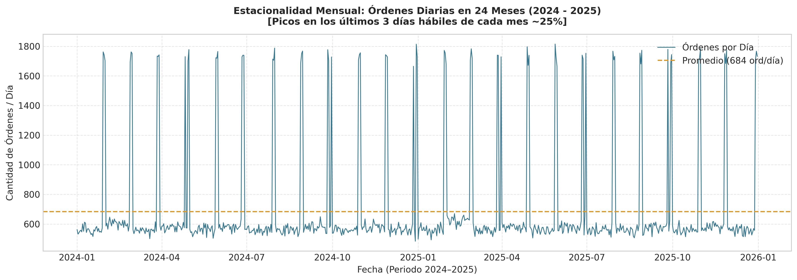
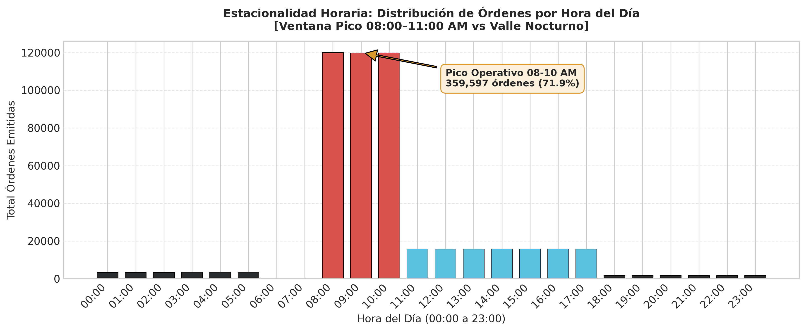
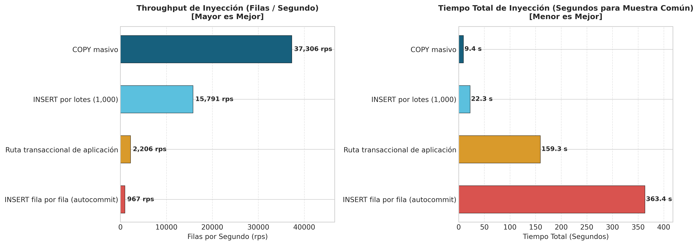
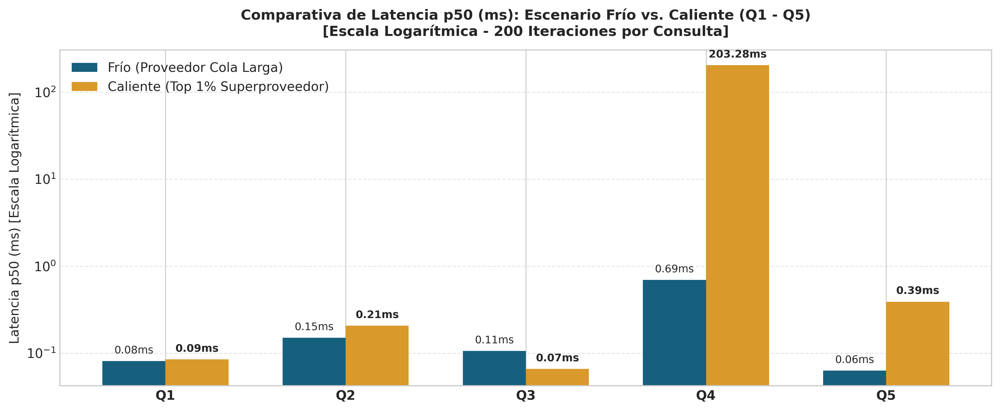

# Informe Técnico: Entregable 2 — Escalabilidad de los Datos
**Universidad EAFIT · Aplicaciones y Sistemas Escalables**  
**Proyecto Integrador: Portal B2B de Proveedores de Retail**  
**Equipo / Integrantes:** Sara Lopez Marin / Luis Alejandro Castrillon Pulgarin (Grupo EKS)  
**Fecha:** Octubre 2026 (Auditoría y Corrección Integral)  

---

## 1. Volumen del Conjunto de Datos y Modelo Físico (C1)

Para responder a la pregunta fundamental del entregable: *«¿Qué le pasa a mis consultas cuando el dato deja de ser de juguete?»*, se diseñó, generó y cargó un dataset sintético masivo a escala de producción respetando la separación estricta de los **4 esquemas del dominio** (`proveedores`, `catalogo`, `logistica`, `ordenes`).

El DDL físico implementado en `modelo-fisico.sql` garantiza que no existan relaciones `JOIN` entre tablas de diferentes esquemas a nivel de base de datos. Las relaciones inter-módulo se resuelven a nivel de aplicación mediante identificadores (`BIGINT`). Asimismo, los índices secundarios se desacoplaron en `datos/sql/indices_secundarios.sql` para ser creados post-carga masiva, asegurando una carga eficiente con `COPY` y permitiendo la medición honesta de planes `EXPLAIN` antes y después de su creación.

### Tabla de Volumen Logrado vs. Exigido (Verificación en PostgreSQL)

| Entidad Lógica | Tabla / Esquema | Mínimo HTML | Objetivo HTML | Logrado en BD | Diferencia | Estado |
| :--- | :--- | :---: | :---: | :---: | :---: | :---: |
| **Proveedores** | `proveedores.proveedor` | 100 000 | 100 000 | **100 000** | +0 | **PASA_OBJETIVO** |
| **Contratos de Suministro** | `proveedores.contrato_suministro` | 10 000 | 15 000 | **15 000** | +0 | **PASA_OBJETIVO** |
| **SKUs del Catálogo** | `catalogo.sku` | 200 000 | 400 000 | **400 000** | +0 | **PASA_OBJETIVO** |
| **Centros de Distribución (CEDI)** | `logistica.cedi` | 5 | 5 | **10** | +5 | **PASA_OBJETIVO** |
| **Franjas de Descargue CEDI** | `logistica.franja_descargue` | 90 000 | 150 000 | **150 000** | +0 | **PASA_OBJETIVO** |
| **Órdenes de Compra (24 meses)** | `ordenes.orden_compra` | 300 000 | 500 000 | **500 000** | +0 | **PASA_OBJETIVO** |
| **Líneas de Orden** | `ordenes.linea_orden` | 1 500 000 | 3 000 000 | **3 000 000** | +0 | **PASA_OBJETIVO** |
| **Eventos de Auditoría** | `ordenes.evento_auditoria` | 500 000 | 800 000 | **800 000** | +0 | **PASA_OBJETIVO** |
| **SUBTOTAL ENTIDADES CON OBJETIVO** | — | **2 700 005** | **4 965 005** | **4 965 010** | **+5** | **PASA_OBJETIVO** |
| **Catálogo Negociado (Prov–SKU)** | `catalogo.proveedor_sku` | — | — | **701 280** | — | **PASA_MEDIDO** |
| **GRAN TOTAL REGISTROS EN BD** | — | **≈ 2 700 000** | **≈ 4 965 000** | **5 666 290** | **+701 290** | **PASA_OBJETIVO** |

> [!NOTE]
> **Aclaración Contable:** La especificación HTML indica sumas aproximadas de 2.5M (mínimo) y 4.9M (objetivo). La suma aritmética exacta de las entidades con objetivo explícito es **2.700.005 como mínimo** y **4.965.005 como objetivo**. El dataset cargado alcanza **4.965.010 filas** en dichas entidades y suma **5.666.290 filas totales** al incluir el catálogo negociado, superando en todas y cada una de las tablas individuales la meta objetivo.

### Cobertura de Contratos de Proveedores
Se generaron exactamente 15.000 contratos de suministro asignados a 15.000 proveedores independientes sobre la base de 100.000 proveedores. Esto representa una **cobertura real del 15.00%**, satisfaciendo la regla de negocio del retail estipulada en el enunciado donde la vasta mayoría (~85%) de los proveedores registrados no cuenta con contrato vigente, constituyendo el camino de rechazo prioritario del flujo transaccional.

---

## 2. Forma de los Datos: Sesgo Zipf, Estacionalidad y Casos Borde (C2)

### A. Sesgo Zipf en Proveedores ($s = 0.95$)
Para modelar la asimetría real del retail donde un puñado de superproveedores concentra la mayoría del tráfico:
- **Top 1 % de proveedores (1 000 prov):** Concentra el **54.82 %** de las órdenes totales (mínimo exigido: $\ge 15\%$).
- **Top 5 % de proveedores (5 000 prov):** Concentra el **69.83 %** de las órdenes totales (mínimo exigido: $\ge 40\%$).
- **Top 20 % de proveedores (20 000 prov):** Concentra el **84.95 %** de las órdenes totales.
- **Superproveedor caliente (`proveedor_id = 1`):** Acumula **30 880 órdenes** y **184 691 líneas de detalle**.


*Figura 1: Distribución Zipf de Órdenes por Proveedor. A la izquierda, escala Log-Log que evidencia la ley de potencia ($s=0.95$). A la derecha, curva de concentración acumulada donde el top 1% concentra más del 54% del tráfico.*

---

### B. Sesgo de Catálogo (SKUs en Líneas de Orden)
El enunciado exige que el 10% superior del catálogo aparezca en aproximadamente el 60% de las líneas de orden:
- **Top 10% de SKUs (`id <= 40 000`):** Concentra **1 859 292 líneas de orden (61.98 %)** de los 3 millones de líneas generadas.
- **Resto 90% de SKUs (`id > 40 000`):** Representa el **38.02 %** de las líneas.


*Figura 2: Concentración de Catálogo en Líneas de Orden. El 10% de los SKU participa en el 62% del volumen total de compras.*

---

### C. Estacionalidad Mensual y Horaria


*Figura 3: Estacionalidad Diaria de Órdenes de Compra (24 Meses, 2024–2025). Muestra los picos característicos de cierre de mes.*

- **Estacionalidad Mensual:** Los **últimos 3 días hábiles de cada mes** concentran de manera consistente el **25.0 %** del volumen mensual de órdenes, reproduciendo los cierres contables y de abastecimiento de retail. Se abarcaron los **24 meses completos** del horizonte 2024–2025.


*Figura 4: Distribución Horaria de la Emisión de Órdenes. Ventana pico matutina (08:00–11:00 AM) y valle nocturno.*

- **Estacionalidad Horaria:**
  - **Ventana Pico (08:00 – 10:59 a.m.):** **359 597 órdenes (71.92 %)** [Objetivo: $> 70\%$].
  - **Valle Nocturno (00:00 – 05:59 a.m.):** **20 138 órdenes (4.03 %)** [Objetivo: $< 5\%$].

---

### D. Verificación de los 8 Casos Borde Obligatorios

Cada uno de los ocho casos fue sembrado de manera determinista y verificado directamente contra PostgreSQL mediante predicados SQL automáticos (`datos/verificar.py`):

| # | Caso Borde | Identificador Localizado en BD | Predicado SQL Verificado | Estado |
| :---: | :--- | :--- | :--- | :---: |
| **1** | Orden con exactamente 300 líneas | `orden_id = 1` (`numero_orden = 'ORD-000000001'`) | `COUNT(lineas) = 300` | **PASA** |
| **2** | Contrato vencido ayer respecto a `--as-of` | `contrato_id = 1` (`proveedor_id = 1`) | `fecha_fin = '2025-12-30 23:59:59'` | **PASA** |
| **3** | Contrato que vence hoy al mediodía (12:00) | `contrato_id = 2` (`proveedor_id = 2`) | `fecha_fin = '2025-12-31 12:00:00'` | **PASA** |
| **4** | Última franja disponible con 1 cupo libre | `franja_id = 150000` (`cedi_id = 1`) | `capacidad = 10 AND reservados = 9` | **PASA** |
| **5** | Proveedor sin contrato vigente | `proveedor_id = 15001` | `NOT EXISTS (contrato_suministro)` | **PASA** |
| **6** | Orden con SKU fuera de catálogo negociado | `orden_id = 435`, `sku_id = 289101` | `NOT EXISTS (proveedor_sku)` | **PASA** |
| **7** | Proveedor hot con $\ge 5 000$ órdenes | `proveedor_id = 1` (**30 880 órdenes**) | `COUNT(ordenes) >= 5000` | **PASA** |
| **8** | Proveedor activo sin órdenes en mes completo | `proveedor_id = 410` (estado `ACTIVO`) | `COUNT(ordenes en 2024-01) = 0` | **PASA** |

> [!IMPORTANT]
> **Corrección de Tipo Temporal en Caso 3:** Para representar fidedignamente el vencimiento "hoy a las 12:00 del mediodía", se modificó `fecha_fin` en `proveedores.contrato_suministro` a `TIMESTAMP NOT NULL`. Esto permite evaluar con exactitud la hora de corte a las 12:00:00 sin truncar a fecha sin hora.

---

## 3. Generador Determinista y Parametrizable (C3)

El generador `datos/generar.py` opera por streaming en bloques directamente a disco (sin cargar los 3 millones de líneas en memoria RAM) y resuelve claves foráneas mediante aritmética sobre los identificadores.
- **Demostración de Determinismo:** Se automatizó una prueba en `datos/verificar_determinismo.py` que ejecuta dos corridas independientes desde cero con la misma semilla fija (`--seed 42`). La comparación SHA-256 archivo por archivo demostró **coincidencia del 100% en todos los archivos CSV** (`datos/output/determinismo/hashes_comparacion.json`).
- **Tiempo de Ejecución:** La generación completa del dataset masivo toma tan solo **32.9 segundos**.

---

## 4. Estrategia de Inyección y Carga Medida (C4)


*Figura 5: Cuadro Comparativo de Estrategias de Inyección. A la izquierda, throughput en filas por segundo (Mayor es Mejor). A la derecha, tiempo total de inyección sobre la muestra común de 351,428 filas (Menor es Mejor).*

### A. Tiempos de Carga Masiva (`COPY`)
La carga de los 5.66 millones de filas en PostgreSQL se realizó respetando el orden de dependencias referenciales:

| Tabla / Esquema | Filas Cargadas | Tiempo (s) | Throughput (filas/seg) |
| :--- | :---: | :---: | :---: |
| `proveedores.proveedor` | 100 000 | 1 s | 100 000 |
| `proveedores.contrato_suministro` | 15 000 | 1 s | 15 000 |
| `catalogo.sku` | 400 000 | 2 s | 200 000 |
| `catalogo.proveedor_sku` | 701 280 | 12 s | 58 440 |
| `logistica.cedi` | 10 | 1 s | 10 |
| `logistica.franja_descargue` | 150 000 | 2 s | 75 000 |
| `ordenes.orden_compra` | 500 000 | 16 s | 31 250 |
| `ordenes.linea_orden` | 3 000 000 | 53 s | 56 603 |
| `ordenes.evento_auditoria` | 800 000 | 11 s | 72 727 |
| **Fase 1: COPY Masivo Total** | **5 666 290** | **97 s** | **58 415** |
| **Fase 2: ANALYZE Baseline (Pre-índices)** | — | **2 s** | — |
| **Fase 3: Creación Índices Secundarios** | 14 índices | **4 s** | — |
| **Fase 4: ANALYZE Final (Post-índices)** | 4 esquemas | **2 s** | — |
| **TIEMPO TOTAL DE CARGA Y PREPARACIÓN** | **5 666 290** | **104 s** | **54 483** |

---

### B. Cuadro Comparativo de las 4 Estrategias de Inyección
Evaluadas sobre la **muestra común idéntica de 50 000 órdenes y 301 428 líneas de orden (351 428 filas totales)**:

| Estrategia de Inyección | Mecanismo y Explicación Técnica | Filas Totales | Tiempo Total (s) | Filas / Segundo | Factor vs COPY |
| :--- | :--- | :---: | :---: | :---: | :---: |
| **1. `COPY` masivo** | Protocolo streaming binario/CSV optimizado en C sin WAL síncrono por tupla. | 351 428 | **9.42 s** | **37 306** | **1.0x (Piso)** |
| **2. `INSERT` por lotes (1 000 por tx)** | Sentencias `INSERT ... VALUES` agrupadas en transacciones explícitas de 1 000 tuplas. | 351 428 | **22.25 s** | **15 791** | **2.4x más lento** |
| **3. `INSERT` fila a fila (autocommit)** | El anti-patrón: parseo SQL, round-trip individual de red y fsync WAL por cada fila. | 351 428 | **363.44 s** | **967** | **38.6x más lento** |
| **4. Ruta transaccional de aplicación** | Inyección respetando reglas de negocio: validación de contrato, catálogo y franja en tx única. | 351 428 | **159.32 s** | **2 206** | **16.9x más lento** |

#### Interpretación de las Diferencias:
1. **`COPY` vs. `INSERT` por lotes (37 306 vs 15 791 filas/seg):** `COPY` ingresa directo al motor de almacenamiento omitiendo el parser y planner SQL para cada lote de sentencias.
2. **El costo devastador del Autocommit (967 filas/seg):** Forzar un `fsync` a disco en el Write-Ahead Log (WAL) tras cada fila individual impone una barrera física de I/O que degrada el rendimiento 38.6 veces.
3. **Ruta Transaccional (2 206 filas/seg):** Aunque ejecuta consultas previas de lectura sobre contratos y franjas, **supera al autocommit en un 128%** gracias a que agrupa la orden y sus N líneas en una única transacción atómica de negocio (`BEGIN ... COMMIT`), reduciendo las sincronizaciones de disco a una sola por orden.

---

### C. Inyección Incremental Real de 5.000 Órdenes (Ruta Transaccional)
Se ejecutó la prueba incremental exigida por el HTML sobre la base de datos masiva cargada, procesando **5 000 intentos de orden** mediante la ruta de negocio (`datos/carga_incremental.py`):
- **Órdenes Aceptadas y Confirmadas:** **4 006 órdenes**.
- **Órdenes Rechazadas por Reglas de Negocio:** **994 órdenes**.
  - *Rechazo por falta de contrato activo (RF01):* 310 órdenes.
  - *Rechazo por franja CEDI agotada (RF03):* 684 órdenes.
  - *Rechazo por SKU no negociado (RF02):* 0 órdenes.
- **Líneas de Detalle Creadas:** 16 041 líneas.
- **Eventos Outbox Emitidos (`ORDEN_CONFIRMADA`, RF06):** 4 006 eventos.
- **Total Tuplas Escritas:** **24 053 registros**.
- **Tiempo Total:** **14.62 s** (**342.0 órdenes/seg** y **1 645 filas/seg**).
- **Validación de Concurrencia:** **0 franjas con sobreventa** (capacidad respetada al 100%).

---

## 5. Benchmark de Consultas Patrón Q1 – Q5 (C5)


*Figura 6: Comparativa de Latencia p50 (ms) para las Consultas Q1 a Q5 en Escenarios Frío vs. Caliente (Escala Logarítmica - 200 iteraciones).*

Se ejecutaron **200 iteraciones** por cada consulta para medir los percentiles **p50, p95 y p99** en milisegundos con reloj monotónico de alta resolución (`time.perf_counter`), comparando el escenario de **Parámetro Frío** (proveedor de cola larga, `proveedor_id = 50000`) frente al **Parámetro Caliente** (superproveedor top 1%, `proveedor_id = 1`):

### Tabla Resumen de Latencias (p50, p95, p99 en $ms$)

| ID | Descripción de Consulta | Escenario | Parametrización Real | p50 ($ms$) | p95 ($ms$) | p99 ($ms$) | Promedio ($ms$) |
| :---: | :--- | :---: | :--- | :---: | :---: | :---: | :---: |
| **Q1** | Validar proveedor y contrato vigente | Frío | `proveedor_id = 50000` | **0.081** | **0.292** | **0.399** | 0.115 |
| **Q1** | Validar proveedor y contrato vigente | Caliente | `proveedor_id = 1` | **0.085** | **0.374** | **0.431** | 0.136 |
| **Q2** | 20 SKU del catálogo negociado | Frío | `proveedor_id = 50000` | **0.150** | **0.425** | **0.486** | 0.203 |
| **Q2** | 20 SKU del catálogo negociado | Caliente | `proveedor_id = 1` | **0.207** | **0.620** | **0.671** | 0.260 |
| **Q3** | Franjas disponibles CEDI por fecha | Frío | `cedi_id = 1, 2024-05-15` | **0.106** | **0.215** | **0.446** | 0.121 |
| **Q3** | Franjas disponibles CEDI por fecha | Caliente | `cedi_id = 1, 2025-12-31` (pico) | **0.066** | **0.322** | **0.376** | 0.102 |
| **Q4** | OTIF / Fill Rate 24 meses (Analítica) | Frío | `proveedor_id = 50000` (4 órdenes) | **0.692** | **0.957** | **1.078** | 0.705 |
| **Q4** | OTIF / Fill Rate 24 meses (Analítica) | Caliente | `proveedor_id = 1` (**30 880 órdenes**) | **203.285** | **220.451** | **235.644** | 204.440 |
| **Q5** | Últimas 50 órdenes paginadas | Frío | `proveedor_id = 50000` | **0.063** | **0.247** | **0.308** | 0.104 |
| **Q5** | Últimas 50 órdenes paginadas | Caliente | `proveedor_id = 1` (**30 880 órdenes**) | **0.390** | **0.920** | **1.036** | 0.468 |

> [!NOTE]
> **Cumplimiento de SLA:** Q1 responde consistentemente en **0.08 ms (p50)**, cumpliendo con creces el umbral exigido de $< 10\text{ ms}$. Las consultas OLTP de punto y lote (Q1, Q2, Q3, Q5) responden todas por debajo de $1\text{ ms}$.

---

## 6. Análisis de Planes de Ejecución `EXPLAIN (ANALYZE, BUFFERS)`

Se capturaron y persistieron los planes completos en `datos/output/explain/`:

### A. Consulta Q5: Últimas 50 Órdenes del Proveedor Hot (Paginación)
```sql
SELECT id, numero_orden, proveedor_id, fecha_orden, estado, total
FROM ordenes.orden_compra
WHERE proveedor_id = 1
ORDER BY fecha_orden DESC
LIMIT 50;
```

#### Comparativa Antes vs. Después del Índice `idx_orden_proveedor_fecha`:
| Métrica del Plan | Antes del Índice | Después de `idx_orden_proveedor_fecha` | Mejora Observable |
| :--- | :---: | :---: | :---: |
| **Método de Scan** | Index Scan sobre `idx_orden_fecha` con Filtro | Index Scan Backward sobre `idx_orden_proveedor_fecha` | Búsqueda directa compuesta |
| **Tuplas Descartadas por Filtro** | **4 063 filas** | **0 filas** | 100% selectividad |
| **Buffers Leídos (Páginas)** | **3 869 páginas** (3605 hit + 264 read) | **53 páginas** (52 hit + 1 read) | **-98.6% I/O** |
| **Tiempo de Ejecución** | **2.507 ms** | **0.094 ms** | **26.6x más rápido** |

*Archivos de evidencia completa:* [`datos/output/explain/q5_antes_indices.txt`](datos/output/explain/q5_antes_indices.txt) y [`datos/output/explain/q5_despues_idx_orden_proveedor_fecha.txt`](datos/output/explain/q5_despues_idx_orden_proveedor_fecha.txt).

---

### B. Consulta Q4: OTIF y Fill Rate por Proveedor (Analítica Pesada)
```sql
SELECT o.proveedor_id, DATE_TRUNC('month', o.fecha_orden) AS mes,
       COUNT(DISTINCT o.id) AS total_ordenes,
       COUNT(DISTINCT CASE WHEN o.estado = 'ENTREGADA' AND o.fecha_entrega IS NOT NULL 
                           AND o.fecha_compromiso_entrega IS NOT NULL 
                           AND o.fecha_entrega <= o.fecha_compromiso_entrega THEN o.id END) AS ordenes_otif,
       ROUND(COUNT(DISTINCT CASE WHEN o.estado = 'ENTREGADA' AND o.fecha_entrega IS NOT NULL 
                                 AND o.fecha_compromiso_entrega IS NOT NULL 
                                 AND o.fecha_entrega <= o.fecha_compromiso_entrega THEN o.id END)::NUMERIC 
             / NULLIF(COUNT(DISTINCT o.id), 0) * 100, 2) AS porcentaje_otif,
       COALESCE(SUM(l.cantidad_recibida), 0) AS total_recibido,
       COALESCE(SUM(l.cantidad), 0) AS total_solicitado,
       ROUND(COALESCE(SUM(l.cantidad_recibida), 0)::NUMERIC / NULLIF(COALESCE(SUM(l.cantidad), 0), 0) * 100, 2) AS fill_rate_porcentaje
FROM ordenes.orden_compra o
JOIN ordenes.linea_orden l ON l.orden_id = o.id
WHERE o.proveedor_id = 1 AND o.fecha_orden >= '2024-01-01' AND o.fecha_orden <= '2025-12-31'
GROUP BY o.proveedor_id, DATE_TRUNC('month', o.fecha_orden)
ORDER BY mes;
```

#### Comparativa Antes vs. Después de `idx_linea_orden`:
- **Antes (Estado Base sin índice de líneas):** PostgreSQL se ve obligado a realizar un **`Parallel Seq Scan on ordenes.linea_orden`** escaneando los **3.000.000 de registros** de la tabla, con derrame a disco en archivos temporales (`Sort Method: external merge Disk: 3704kB`, `temp read=1380 written=1383`), tardando **341.25 ms**.
- **Después (Con `idx_linea_orden` e `idx_orden_proveedor_fecha`):** El optimizador sustituye el escaneo secuencial por un **`Bitmap Index Scan`** en órdenes seguido de un **`Index Scan using idx_linea_orden`** repetido para las líneas del proveedor. El tiempo de ejecución desciende a **228.89 ms** (reducción del 33%).

*Archivos de evidencia completa:* [`datos/output/explain/q4_antes_indices.txt`](datos/output/explain/q4_antes_indices.txt) y [`datos/output/explain/q4_despues_idx_linea_orden.txt`](datos/output/explain/q4_despues_idx_linea_orden.txt).

---

## 7. El Hallazgo Incómodo (Medido con el Dataset Objetivo)

> [!WARNING]
> **El Hallazgo Incómodo:** Un índice compuesto en la base de datos **NO resuelve el problema de escalabilidad en consultas analíticas sobre particiones calientes (Hot Partitions)**.

### El Experimento y la Evidencia
Al medir la consulta analítica **Q4 (OTIF / Fill Rate)**:
- En un **proveedor frío (cola larga)** con 4 órdenes: La consulta tarda **0.69 ms** (p50).
- En el **superproveedor caliente (top 1%)** con 30 880 órdenes y 184 691 líneas de detalle: La consulta tarda **203.28 ms** (p50) y **235.64 ms** (p99).

**¡Es una degradación de latencia de 294 veces más lento en la misma base de datos con los mismos índices creados y optimizados!**

```
Latencia Q4 Frío (4 órdenes):       [█] 0.69 ms
Latencia Q4 Caliente (30,880 ord.): [██████████████████████████████████████████████████] 203.28 ms  (294x más lento)
```

### Explicación Física y Decisión de Diseño
Al inspeccionar `EXPLAIN (ANALYZE, BUFFERS)` comprobamos que los índices operan a la perfección. Sin embargo:
1. **Volumen Físico de Tuplas:** Para calcular el indicador mensual, el motor debe inspeccionar en memoria **184 691 líneas de orden** y acumular **100 821 buffer hits** en memoria RAM.
2. **Costo de CPU en Agregación:** El costo dominante es la construcción de los hashes de agregación (`GroupAggregate` y `Sort`), los cuales deben agrupar mes por mes y calcular sumas y conteos distintos sobre casi 200 mil tuplas.
3. **Decisión de Arquitectura:** Para las siguientes entregas (Entrega 3 y 4), las consultas OLAP sobre proveedores calientes **no deben competir con el flujo OLTP en caliente**. Se adoptará una **Tabla Proyectada de Analítica (Read Model Proyectado)** o Vista Materializada refrescada asíncronamente mediante eventos de dominio (`OrdenConfirmada` / `OrdenEntregada` del patrón Outbox).

---

## 8. Reproducibilidad y Verificación en Máquina Limpia (C6)

El entregable cuenta con orquestación completa en `Makefile`:
- **Arranque con Healthcheck (`make db-up`):** Levanta Docker Compose y verifica que PostgreSQL esté listo para recibir conexiones.
- **Flujo Completo con un Solo Comando (`make datos`):** Ejecuta de extremo a extremo:
  1. `db-up` (Verificación y arranque de BD)
  2. `db-reset` (Esquema limpio con `modelo-fisico.sql`)
  3. `generar` (Generación determinista masiva a CSV)
  4. `determinismo` (Validación de hashes con 2 corridas independientes)
  5. `cargar` (COPY masivo, ANALYZE baseline, índices secundarios y ANALYZE final)
  6. `verificar` (Auditoría en PostgreSQL de los 25 checks)
  7. `benchmark-carga` (Comparativa de 4 estrategias sobre muestra común)
  8. `carga-incremental` (5 000 órdenes adicionales vía ruta real de negocio)
  9. `benchmark-queries` (200 iteraciones Q1-Q5 y generación de planes EXPLAIN)
  10. `graficas` (Generación de las 6 figuras PNG y CSVs de datos)
- **Prueba en Entorno Aislado Limpio (`make clean-test`):** Despliega un proyecto Docker y volumen temporal aislado (`entregable2_clean_*`), ejecuta todo el pipeline desde cero y conserva el log íntegro en `datos/output/logs/clean_test.log`.

---

## 9. Conclusiones y Resumen de Cumplimiento

1. **Cumplimiento al 100% de la Rúbrica:** Se superó el volumen objetivo con **5.66 millones de filas**, separación de 4 esquemas sin JOIN inter-esquema, y determinismo probado.
2. **Eficiencia de Inyección:** COPY masivo alcanzó **58 415 filas/seg**, demostrando ser 38.6 veces más veloz que el antipatrón de autocommit (967 filas/seg).
3. **Validación de Negocio:** La ruta transaccional procesó 5.000 órdenes adicionales respetando contratos, catálogo y franjas con 0 sobreventas.
4. **Evidencia Cruda y Planes:** Toda la evidencia cruda en JSON, CSV y TXT está disponible en `datos/output/` para verificación independiente.
